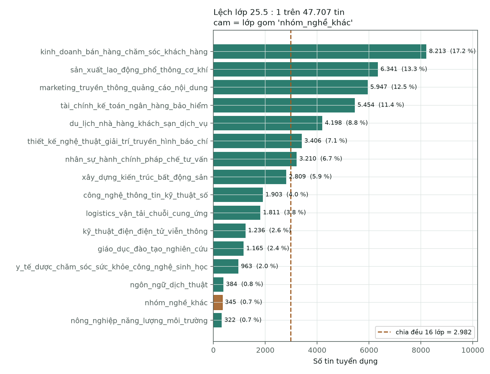
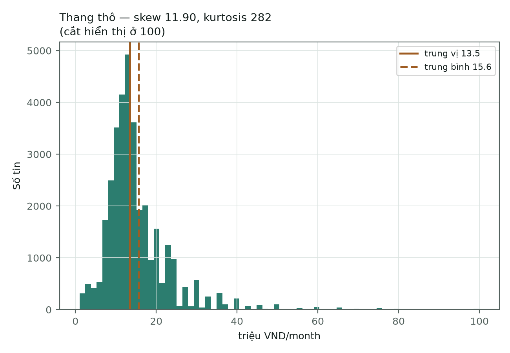
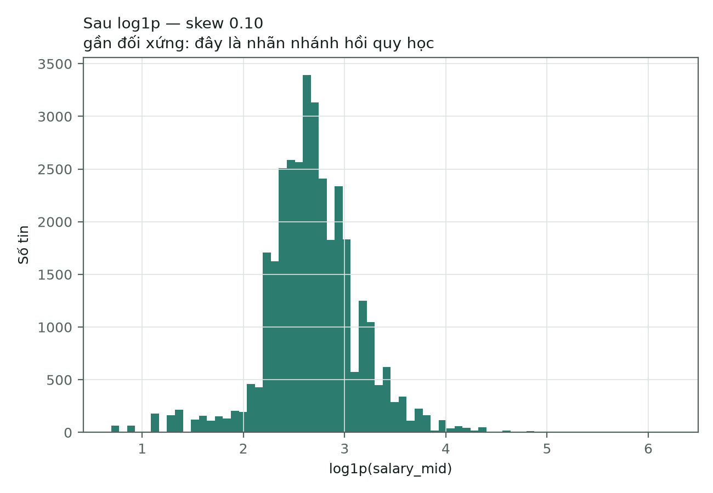
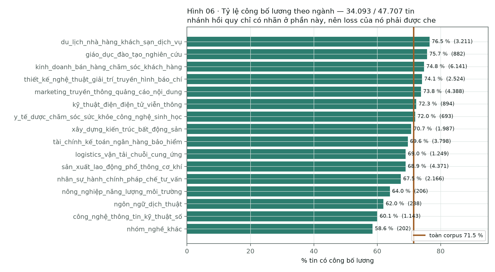
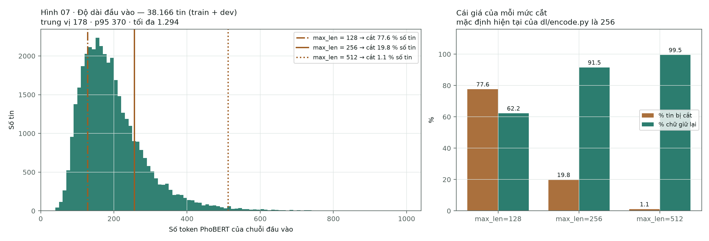

[← Chương 2](03-chuong-2-tong-quan.md) · [Bảng điều khiển](00-index.md) · [Chương 4 →](05-chuong-4-thuc-nghiem.md)

# CHƯƠNG 3. BỘ DỮ LIỆU VIETJOBS

---

## 3.1. Nguồn dữ liệu và kiểm toán dữ liệu

Bộ dữ liệu của đề tài là bộ VietJobs do Phạm Dinh, Nguyễn Huy và El-Haj công bố [13], dưới
dạng tệp `VietJobs.csv` gồm 48.092 tin tuyển dụng tiếng Việt và 18 cột. Đơn vị lương là
triệu đồng mỗi tháng. Mã băm sha256 của tệp được ghi vào tệp `manifest.json`: nếu tệp thô
thay đổi, mọi con số đã đo mất tính so sánh, và điều đó phải được phát hiện ngay.

**Bảng 3.1: Các nhóm trường dữ liệu**

| Nhóm | Các cột | Vai trò |
|---|---|---|
| Văn bản tự do | `job_title`, `description`, `requirements_text` | Đầu vào của mô hình |
| Danh sách | `qualifications`, `technical_skills`, `soft_skills`, `benefits` | Không đưa vào mô hình |
| Có cấu trúc | `location`, `country`, `languages_required`, `experience_required`, `contract_type`, `working_hours` | Không đưa vào mô hình |
| Nhãn | `category`, `salary`, `salary_min`, `salary_max`, `salary_avg` | Đáp án, không bao giờ là đầu vào |

Toàn bộ các cột được đọc dưới dạng chuỗi; chỉ chuỗi rỗng mới được coi là giá trị khuyết.
Để thư viện tự suy kiểu sẽ âm thầm biến "01" thành 1, hoặc biến "NA" thành giá trị khuyết.

Ba trường văn bản mà mô hình đọc – tiêu đề, mô tả và yêu cầu – được điền ở gần như mọi dòng
(100 %, 100 % và 99,98 %; chỉ 9 dòng để trống trường yêu cầu). Các trường điền thưa nhất là
`technical_skills` (86,6 %) và `languages_required` (25,6 %). Một trường rỗng ở ba dòng
trên bốn không phải là một đặc trưng, nên không được đưa vào mô hình.

> **Nguồn số liệu:** `data/processed/manifest.json` (`source_rows` = 48.092,
> `source_sha256`, `salary_unit`) · `artifacts/eda/summary.json` (`completeness`) ·
> `src/vietjobs/dl/text.py` (`FIELDS`: ba trường mô hình đọc).

---

## 3.2. Loại trùng lặp và sửa nhãn lương

Trùng lặp được xử lý ở hai tầng, với hai mục đích khác nhau.

**Bảng 3.2: Hai tầng xử lý trùng lặp**

| Tầng | Việc làm | Kết quả |
|---|---|---|
| 1. Trùng khớp hoàn toàn | Xóa dòng giống nhau trên cả 18 cột | 48.092 → 47.707 (xóa 385) |
| 2. Gom nhóm tin đăng lại | Không xóa, chỉ gán mã nhóm chung | 47.707 dòng → 34.899 nhóm |

Dòng giống nhau trên cả 18 cột là lỗi nhập liệu và bị xóa. Tin đăng lại – cùng tiêu đề, mô
tả và yêu cầu, chỉ khác chữ hoa, dấu thanh hoặc dấu câu – vẫn là dữ liệu thật nên được giữ
lại. Cả nhóm được gán chung một mã nhóm để luôn rơi vào cùng một tập (§3.4). Có 12.808 dòng
(26,8 %) là tin đăng lại; nhóm lớn nhất có 33 dòng.

Mã nhóm được tính từ tiêu đề, mô tả và yêu cầu sau khi đưa về chữ thường, bỏ dấu tiếng Việt
và dấu câu. Vì vậy nó chỉ gom các tin giống hệt nhau ở ba trường này; khác nhau một từ là
khác nhóm. So mỗi tin test với tin train giống nhất theo Jaccard trên tập từ của ba trường,
1.089 tin test (11,4 %) có một bản trong train giống từ 90 % trở lên. Ở 773 cặp mà cả hai
tin cùng công bố lương, lương trùng nhau 82,8 %, nhưng nhãn ngành của các cặp chỉ trùng
30,6 %.

Kể cả ở 217 tin test có tập từ trùng hoàn toàn với một tin train, nhãn ngành chỉ trùng
19,4 %. Một nội dung gần như giống hệt mang nhiều nhãn khác nhau, nên trên những tin này
không mô hình nào đúng được mọi nhãn. Đây là phần lỗi nằm ở nhãn, không nằm ở mô hình;
nguyên nhân chưa được đo.

Mô hình chốt được chấm thêm trên phần test bỏ các tin gần trùng. Tệp test không bị sửa;
phép đo chỉ để biết điểm lệch bao nhiêu, không dùng để chọn mô hình.

**Bảng 3.3: Điểm của mô hình chốt trên toàn bộ test và trên phần sạch**

| Phần test | Số tin | macro-F1 | Số tin có lương | MAE (triệu) |
|---|---|---|---|---|
| Toàn bộ | 9.541 | 0,6278 | 6.773 | 3,923 |
| Bỏ tin gần trùng với train | 8.452 | 0,6488 | 5.965 | 4,109 |
| Bỏ tin gần trùng với train hoặc dev | 8.229 | 0,6511 | 5.796 | 4,116 |

Tin gần trùng vì vậy không thổi phồng macro-F1, nhưng làm MAE trên toàn bộ test thấp hơn
thực tế một chút.

Nhãn lương được sửa bằng bốn phép, mỗi phép ứng với một dạng lỗi có thật trong dữ liệu.

**Bảng 3.4: Bốn phép sửa nhãn lương**

| Hiện tượng | Cách sửa |
|---|---|
| `salary_min` > `salary_max` | Hoán đổi hai biên |
| Chỉ công bố một biên | Dùng biên có thật cho cả hai |
| Không công bố con số nào | `salary_disclosed` = 0, không dùng làm nhãn lương |
| Phân bố lệch phải nặng | Nhãn hồi quy là `log1p(salary_mid)` |

Phần đuôi phải được giữ lại: 2.204 tin nằm trên hàng rào IQR 28 triệu. Ở hai biên có 15 tin
trên 200 triệu và 132 tin dưới 2 triệu, nghi nhập sai đơn vị; các tin này chưa được xử lý.
Cái đuôi được xử lý bằng phép biến đổi `log1p` trên nhãn.

> **Nguồn số liệu:** `data/processed/manifest.json` (`rows_after_exact_dedup` = 47.707,
> `dropped_exact_duplicates` = 385, `unique_groups` = 34.899) ·
> [01-data-audit.md](../01-data-audit.md) §2 (nhóm lớn nhất 33 dòng) ·
> `src/vietjobs/vitext.py` (`group_key`) · `artifacts/eda/near_dup_test.json` (`rows[0]`:
> 217 tin, nhãn trùng 0,1935; `rows[2]`: 1.089 tin, 0,1141, nhãn trùng 0,3058, 773 cặp,
> lương trùng 0,8279) · `artifacts/dl-mtl-caf-rnn-b01-cw-s42-v2/metrics_test.json` và
> `metrics_test_clean.json` (`clean`, `clean_train_dev`) · `src/vietjobs/dataset.py`
> (`derive_salary`) · `artifacts/eda/summary.json` (`salary.n_above_fence` = 2.204,
> `fence_high` = 28, `n_implausible_high` = 15, `n_implausible_low` = 132).

---

## 3.3. Cơ chế chống rò rỉ dữ liệu

Rò rỉ dữ liệu là khi mô hình nhìn thấy thông tin mà lúc dự đoán thật nó không có. Với bài
toán lương, đường rò rỉ là chính con số lương được nhắc lại trong văn bản tin đăng. Lỗi này
không sinh ra thông báo nào; nó chỉ tạo ra một điểm số đẹp không có giá trị.

Mỗi cột văn bản vì vậy được dựng sẵn hai họ: họ gốc (raw) cho bài toán phân loại, và họ đã
che (masked) cho bài toán lương, trong đó mọi con số lương được thay bằng một ký hiệu. Hàm
`features.resolve_column` là nơi duy nhất quyết định bài toán nào đọc họ nào. Vectơ của hai
họ cũng được lưu thành hai tệp riêng. Cột phúc lợi là cột nhắc lại con số lương nhiều nhất,
ở 10,65 % số dòng.

Ràng buộc này được giữ bằng bộ kiểm thử tự động `tests/test_no_leak.py` và
`tests/test_dl_text.py`. Ba cột không nằm trong danh sách bảo vệ – `soft_skills_text`,
`qualifications_text`, `technical_skills_text` – đã được đo có 0 dòng chứa con số lương.

> **Nguồn số liệu:** `src/vietjobs/features.py` (`resolve_column`) ·
> [02-vietnamese-nlp.md](../02-vietnamese-nlp.md) bảng chín bước, bước 4 (benefits 5.081
> dòng, 10,65 %) · `tests/test_no_leak.py` (`test_skill_columns_carry_no_pay_figures`).

---

## 3.4. Phân chia tập dữ liệu

Dữ liệu được chia theo nhóm tin đăng lại chứ không theo dòng. Mỗi nhóm được xếp vào tầng
theo nhãn phổ biến nhất của nhóm. Trong mỗi tầng, các nhóm được xáo trộn, rồi nhóm lớn nhất
được đặt trước vào tập đang thiếu nhiều nhất so với hạn mức. Mã nguồn khẳng định không nhóm
nào nằm ở hai tập; cả 16 lớp đều có mặt ở ba tập.

Phép chia chạy hai tầng: train và test theo tỷ lệ 8:2, rồi phần train chia tiếp thành train
và dev theo tỷ lệ 9:1, với hạt giống 20260826. Chia hai tầng cho phép thay đổi lát cắt dev
mà không một dòng nào của test bị dịch chuyển.

**Bảng 3.5: Kết quả phân chia tập dữ liệu**

| Tập | Số dòng | Tỷ lệ | Tin có công bố lương | Số lớp |
|---|---|---|---|---|
| train | 34.354 | 72,01 % | 24.622 | 16 |
| dev | 3.812 | 7,99 % | 2.698 | 16 |
| test | 9.541 | 20,00 % | 6.773 | 16 |

Số nhóm bị tách qua hai tập là 0, và điều này được kiểm tra bằng một câu lệnh `assert` trong
mã nguồn. Tập dev dùng để chọn mô hình và siêu tham số. Tập test không dùng để chọn mô hình
và không bao giờ bị biến đổi; các cấu hình trên bảng kết quả được chấm trên test nhiều nhất
một lần, từ checkpoint đã lưu. Cái giá của lược đồ này là tập dev mỏng: lớp
`nhóm_nghề_khác` chỉ có 25 dòng trong dev.

> **Nguồn số liệu:** `src/vietjobs/dataset.py` (`group_stratified_split`,
> `two_stage_split`, `assert` trong `build`) · `data/processed/manifest.json`
> (`split_seed` = 20260826, `split_test_fraction` = 0,2, `split_dev_fraction` = 0,1,
> `groups_straddling_splits` = 0, `splits.{train,dev,test}.rows`, `.salary_disclosed`,
> `.categories`) · đếm `category` trên `dev.csv` (25 dòng `nhóm_nghề_khác`).

---

## 3.5. Phân tích khám phá dữ liệu

Mọi con số mô tả trong mục này đo trên tệp gốc sau khi loại trùng khớp hoàn toàn, 47.707
dòng, tức toàn bộ kho dữ liệu như đã thu thập. Ba con số phục vụ quyết định mô hình được đo
trên tập chia, và ghi rõ phạm vi tại chỗ: mốc đoán lớp lớn nhất (§3.5.1), độ dài chuỗi token
và tỷ lệ cắt của CafeBERT (§3.5.4).

### 3.5.1. Độ lệch lớp

**Bảng 3.6: Số tin và tỷ lệ công bố lương của 16 nhóm ngành nghề (tệp gốc, 47.707 tin)**

| Nhóm ngành nghề | Số tin | Tỷ lệ | Tỷ lệ công bố lương | Trung vị lương (triệu) |
|---|---|---|---|---|
| `kinh_doanh_bán_hàng_chăm_sóc_khách_hàng` | 8.213 | 17,2 % | 74,8 % | 14,0 |
| `sản_xuất_lao_động_phổ_thông_cơ_khí` | 6.341 | 13,3 % | 68,9 % | 12,5 |
| `marketing_truyền_thông_quảng_cáo_nội_dung` | 5.947 | 12,5 % | 73,8 % | 12,5 |
| `tài_chính_kế_toán_ngân_hàng_bảo_hiểm` | 5.454 | 11,4 % | 69,6 % | 13,0 |
| `du_lịch_nhà_hàng_khách_sạn_dịch_vụ` | 4.198 | 8,8 % | 76,5 % | 12,5 |
| `thiết_kế_nghệ_thuật_giải_trí_truyền_hình_báo_chí` | 3.406 | 7,1 % | 74,1 % | 13,5 |
| `nhân_sự_hành_chính_pháp_chế_tư_vấn` | 3.210 | 6,7 % | 67,5 % | 12,5 |
| `xây_dựng_kiến_trúc_bất_động_sản` | 2.809 | 5,9 % | 70,7 % | 16,0 |
| `công_nghệ_thông_tin_kỹ_thuật_số` | 1.903 | 4,0 % | 60,1 % | 16,0 |
| `logistics_vận_tải_chuỗi_cung_ứng` | 1.811 | 3,8 % | 69,0 % | 12,5 |
| `kỹ_thuật_điện_điện_tử_viễn_thông` | 1.236 | 2,6 % | 72,3 % | 13,5 |
| `giáo_dục_đào_tạo_nghiên_cứu` | 1.165 | 2,4 % | 75,7 % | 13,5 |
| `y_tế_dược_chăm_sóc_sức_khỏe_công_nghệ_sinh_học` | 963 | 2,0 % | 72,0 % | 14,0 |
| `ngôn_ngữ_dịch_thuật` | 384 | 0,8 % | 62,0 % | 15,0 |
| `nhóm_nghề_khác` | 345 | 0,7 % | 58,6 % | 11,0 |
| `nông_nghiệp_năng_lượng_môi_trường` | 322 | 0,7 % | 64,0 % | 14,0 |
| **Tổng** | **47.707** | **100 %** | **71,5 %** | **13,5** |

Lớp lớn nhất có 8.213 tin, lớp nhỏ nhất 322 tin, tỷ lệ lệch 25,5:1. Bốn lớp lớn nhất chiếm
54,4 % dữ liệu, bốn lớp nhỏ nhất chỉ 4,2 %. Hệ số Gini của cỡ lớp là 0,439 và độ dốc Zipf
là −1,18: độ lệch là một dải liên tục, không có ngưỡng tự nhiên nào để tách ra vài lớp hiếm.

Hệ quả cho việc đánh giá: luôn đoán lớp lớn nhất (học trên train, chấm trên dev) đã cho
accuracy 0,2062 nhưng macro-F1 chỉ 0,0214. Vì vậy độ đo chính của bài toán phân loại là
macro-F1.

**Hình 3.1: Phân bố số tin theo 16 nhóm ngành nghề**

> **Nguồn số liệu:** `artifacts/eda/summary.json` (`class_counts`, `per_category[*]`,
> `imbalance_ratio` = 25,51, `distribution.top4_share`, `bottom4_share`, `gini`,
> `zipf_slope`, `floors`) · `docs/figures/eda/eda-02a-lech-lop.png`.

### 3.5.2. Phân bố mức lương

**Bảng 3.7: Hình dạng phân bố mức lương (34.093 tin có công bố lương)**

| Đại lượng | Giá trị |
|---|---|
| Trung vị | 13,5 |
| Trung bình | 15,6 |
| Giá trị lớn nhất | 500,0 |
| Độ lệch – thang thô | 11,90 |
| Độ lệch – sau `log1p` | 0,10 |
| p01 · p05 · p25 · p75 · p95 · p99 | 2,5 · 6,5 · 10,5 · 17,5 · 30,0 · 50,0 |

Trung bình 15,6 triệu cao hơn trung vị 13,5 triệu, dấu hiệu của đuôi phải. Sau phép biến
đổi `log1p`, độ lệch giảm từ 11,90 xuống 0,10, gần như đối xứng. Vì vậy mô hình học trên
`log1p` của lương, và mọi kết quả được quy đổi ngược về triệu đồng.

Ngành nghề gần như không nói gì về lương: phân rã phương sai của log-lương theo 16 ngành cho
eta² = 0,032, tức ngành chỉ giải thích 3,2 % biến thiên. Trung vị lương theo ngành chỉ trải
từ 11,0 đến 16,0 triệu. Tín hiệu lương nằm trong chi tiết của tin đăng – cấp bậc, kinh
nghiệm, ngoại ngữ – chứ không ở nhãn ngành.

**Hình 3.2: Phân bố mức lương trước và sau phép biến đổi `log1p`**

> **Nguồn số liệu:** `artifacts/eda/summary.json` (`salary`, `variance.eta_squared_log` =
> 0,0317, `per_category[*].median`) · `docs/figures/eda/eda-05a-thang-tho.png`,
> `eda-05b-sau-log1p.png`.

### 3.5.3. Tỷ lệ công bố lương

34.093 trên 47.707 tin có công bố lương, tức 71,5 %. Theo ngành, tỷ lệ này trải từ 58,6 %
(`nhóm_nghề_khác`) đến 76,5 % (du lịch – nhà hàng – khách sạn – dịch vụ). Tương quan Pearson
giữa tỷ lệ công bố và logarit cỡ lớp là 0,610 (p = 0,0122).

Hệ quả: bài toán lương chỉ học và chấm trên các tin có công bố lương; 28,5 % còn lại không
được gán nhãn 0. Vì việc công bố phụ thuộc ngành, mô hình lương học trên một mẫu đã bị chọn
lọc, và các ngành nhỏ chịu thiệt hai lần.

**Hình 3.3: Tỷ lệ tin có công bố mức lương theo ngành nghề**

> **Nguồn số liệu:** `artifacts/eda/summary.json` (`disclosure_rate` = 0,7146,
> `per_category[*].disclosure_rate`, `distribution.size_vs_disclosure_pearson_logn` =
> 0,6097, `size_vs_disclosure_p` = 0,0122) · `docs/figures/eda/eda-06-cong-bo-luong.png`.

### 3.5.4. Độ dài văn bản

Đo trên train và dev (38.166 tin) bằng tokenizer của PhoBERT, độ dài chuỗi ghép ba trường có
trung vị 178 token, p95 là 370 token và tối đa 1.294 token.

**Bảng 3.8: Tỷ lệ tin bị cắt theo độ dài tối đa (train và dev, tokenizer PhoBERT)**

| Độ dài tối đa (token PhoBERT) | Tỷ lệ tin bị cắt | Tỷ lệ token còn giữ |
|---|---|---|
| 128 | 77,6 % | 62,2 % |
| 256 (giới hạn của PhoBERT) | 19,8 % | 91,5 % |
| 512 | 1,1 % | 99,5 % |

PhoBERT chỉ nhận tối đa 256 token, nên 19,8 % số tin bị cắt dù vẫn giữ 91,5 % tổng số token.
CafeBERT nhận 512 token; với tokenizer của CafeBERT, chỉ 5,7 % tin trong dev và 4,5 % tin
trong train bị cắt. Đây là một trong những lý do CafeBERT được xem xét thay cho PhoBERT ở
Chương 5.

**Hình 3.4: Phân bố độ dài chuỗi sau khi tách bằng tokenizer PhoBERT**

> **Nguồn số liệu:** `artifacts/eda/token_lengths.json` (`n` = 38.166, `median` = 178,
> `p95` = 370, `max` = 1.294, `truncated_share`, `tokens_kept_share`) ·
> `artifacts/embeddings/cafebert-{train,dev}-masked-len512.json` (`truncated_frac` =
> 0,0446 / 0,0572) · `docs/figures/eda/eda-07-do-dai-token.png`.

---

[← Chương 2](03-chuong-2-tong-quan.md) · [Chương 4 →](05-chuong-4-thuc-nghiem.md)
