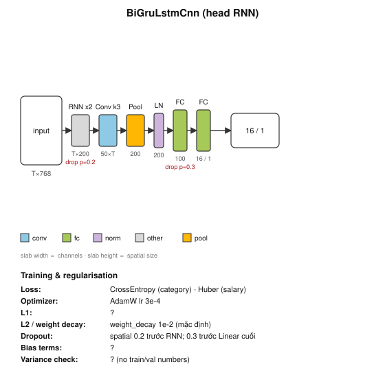

# Head RNN: Bi-GRU ‖ Bi-LSTM → CNN

Source: `src/vietjobs/dl/heads.py:76-142` (lớp `BiGruLstmCnn`), cấu hình chạy ở `src/vietjobs/dl/train_dl.py`. Cấu hình của run `dl-cat-rnn-ce`: `--hidden 100 --conv-channels 50`, `branches=both`.

Cách đọc:
- Sơ đồ chỉ vẽ **một nhánh**. Trong code có **hai nhánh song song** (GRU và LSTM), mỗi nhánh có RNN riêng và Conv riêng. Skill này chưa vẽ được nhánh song song.
- `T` là số token thật (tối đa 256). Đầu vào là vector PhoBERT đóng băng cho từng token, không phải vector đã trung bình.
- `RNN x2` là hai nhánh GRU và LSTM. Hộp `Pool` có 200 chiều vì ghép avg và max của cả hai nhánh (2 nhánh × 2 × 50).

| Lớp | Cấu hình | Shape ra | Ghi chú |
|---|---|---|---|
| SpatialDropout | `nn.Dropout2d(0.2)` | T×768 | tắt cả một kênh trên mọi bước |
| pack_padded_sequence | theo độ dài thật | T×768 | chiều ngược bắt đầu từ token thật cuối |
| Bi-GRU | hidden 100, bidirectional | T×200 | nhánh 1 |
| Bi-LSTM | hidden 100, bidirectional | T×200 | nhánh 2 |
| Conv1d (mỗi nhánh) | k=3, padding 1, 200→50, GELU | 50×T | |
| avg ‖ max pool (mỗi nhánh) | có mặt nạ pad (max điền -inf) | 100 | |
| concat | 2 nhánh | 200 | |
| LayerNorm | 200 | 200 | |
| Linear + GELU | 200→100 | 100 | |
| Dropout | p=0.3 | 100 | |
| Linear | 100→out | 16 (category) / 1 (salary) | |

Bản đa nhiệm `MultiTaskRnn` (`heads.py:145`) dùng chung thân này và có hai đầu ra (phân lớp và lương).

Số tham số: chưa chạy `sum(p.numel())` nên không ghi. Biến thể khác (T11, CafeBERT…) chỉ đổi `in_dim` và kích thước `--hidden`.

Phần Training: L1 và bias chưa kiểm nên hiện `?`. Chưa có số train/val trong file này, nên không đánh giá phương sai.
